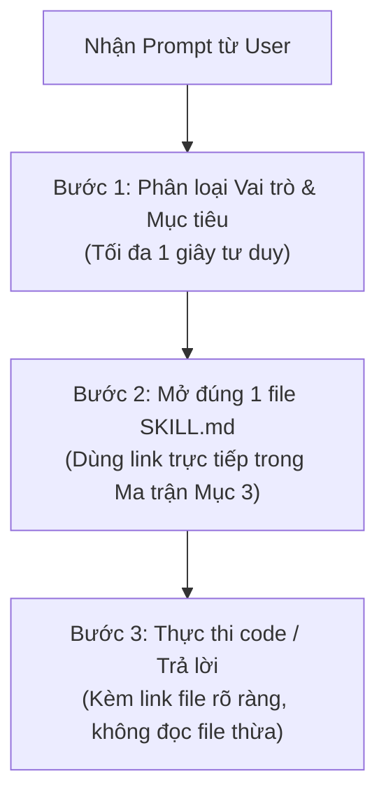

# BẢN ĐỒ ĐIỀU HƯỚNG SKILL & GIAO THỨC TỐI ƯU HÓA TOKEN (SKILLS ROUTING INDEX)

> **Dành cho mọi AI Agent hoạt động trong dự án CDTN2 (Freelance Marketplace)**  
> **Phiên bản:** 2.0 | **Ngày cập nhật:** 13/10/2026  
> **Trạng thái an toàn mã nguồn:** :white_check_mark: **100% PASSED** (0 mã độc, 0 backdoor, 0 data exfiltration, 0 hardcoded secrets)

---

## 1. BÁO CÁO KIỂM TOÁN AN TOÀN SKILL (SECURITY AUDIT REPORT)

Hệ thống đã thực hiện quét tĩnh và phân tích toàn diện **910 files** (208.132 dòng mã, xấp xỉ 2,33 triệu tokens) trong toàn bộ thư mục `.agent/` cùng 206 files plugins/builtin skills:

| Tiêu chí kiểm tra | Kết quả quét | Đánh giá & Kết luận |
|---|---|---|
| **Backdoor / Reverse Shells** | **0 phát hiện** | An toàn tuyệt đối. Không có socket lén lút, không có netcat, telnet hay named-pipe reverse shell. |
| **Data Exfiltration / C2 Webhooks** | **0 phát hiện** | Không có kết nối tới ngrok, webhook.site, requestbin, discord webhook, pastebin, telegram bot. |
| **Credential / Secret Theft** | **0 phát hiện** | Không có script đọc trộm `~/.ssh`, `id_rsa`, `.aws/credentials`, `/etc/shadow`, hay gửi token ra ngoài. |
| **Destructive Actions** | **24 hits (False Positive)** | Tất cả là tài liệu hướng dẫn gỡ cài đặt (`rm -rf ~/.claude/skills/...`) hoặc ví dụ cảnh báo lỗ hổng YAML/Pickle trong tài liệu bảo mật `sharp-edges`. |
| **Prompt Injection / Jailbreak** | **6 hits (False Positive)** | Toàn bộ 6 điểm phát hiện là **chỉ dẫn phòng thủ** (Defensive Guardrails) trong `browser-testing-with-devtools` và `source-driven-development` nhằm răn đe agent không được làm theo lệnh lạ từ web ngoài. |
| **Dynamic Execution (`eval`/`exec`)** | **110 hits (False Positive)** | Toàn bộ là quy tắc cảnh báo trong tài liệu bảo mật (`security-best-practices`, `sharp-edges`) và pattern test của bộ phân tích tĩnh `static-analysis`. |
| **Script tiện ích (.py, .sh, .js, .ts)** | **46 scripts hợp lệ** | Chứa các lệnh subprocess chuẩn để gọi LibreOffice chuyển docx, gọi `gh` CLI xem PR, chạy test CodeQL/Semgrep, và bật test server cục bộ. |

:shield: **KẾT LUẬN:** Toàn bộ kho skill của dự án hoàn toàn **SẠCH VÀ AN TOÀN**, sẵn sàng sử dụng.

---

## 2. NGUYÊN TẮC VÀNG TỐI ƯU HÓA TOKEN (ZERO-TOKEN-WASTE PROTOCOL)

Thư mục `.agent/` chứa hơn **2,33 triệu token dữ liệu**. Nếu một Agent quét thư mục bừa bãi hoặc đọc cả thư mục lớn, context window sẽ cạn kiệt ngay lập tức. Mọi Agent **BẮT BUỘC** tuân thủ 4 nguyên tắc sau:

### :no_entry_sign: 1. Tuyệt đối KHÔNG quét / liệt kê thư mục (No Directory Sprawling)
- **CẤM:** Chạy `Get-ChildItem -Recurse`, `find .`, `ls -R`, hoặc dùng công cụ xem danh sách thư mục `.agent/` khi tìm kiếm skill.
- **CHUẨN:** Nhìn vào **Bảng tra cứu Ma trận (Mục 3)** bên dưới, lấy chính xác đường dẫn file `SKILL.md` và mở trực tiếp bằng công cụ xem file.

### :dart: 2. Nạp lũy tiến & Đích danh (Single Skill Targeted Loading)
- Mỗi tác vụ chỉ mở duy nhất **1 file `SKILL.md`** đại diện cho nhiệm vụ cốt lõi.
- Chỉ mở thêm file thứ 2 khi có sự kết hợp đặc thù (ví dụ: làm UI đẹp cần mở `frontend-ui-engineering` kết hợp `ui-ux-pro-max`).
- **CẤM:** Không đọc đồng thời nhiều hơn 2 skill trong một phiên làm việc.

### :octagonal_sign: 3. Chặn nạp thư mục con nặng (Subfolder Blacklist)
- Nhiều skill có thư mục con chứa hàng chục nghìn dòng dữ liệu mẫu, test case, schema:
  - `skills/api-skill/` (chứa 20 thư mục con về postman, newman, compliance...) -> **Chỉ đọc `SKILL.md`**.
  - `skills/sharp-edges/references/` (hàng chục file tài liệu ngôn ngữ) -> **Chỉ đọc khi cần tra cứu lỗi ngôn ngữ cụ thể**.
  - `skills/static-analysis/` (chứa các rule CodeQL, Semgrep, tests) -> **Chỉ đọc `SKILL.md`**.
  - `skills/docx/` -> **Chỉ đọc `SKILL.md`** và chạy script khi cần chuyển đổi báo cáo.

### :pushpin: 4. Đọc theo phạm vi dòng (Slice Reading)
- Khi một file `SKILL.md` dài hơn 300 dòng, dùng tham số `StartLine` và `EndLine` để chỉ lấy đúng phần hướng dẫn cần thiết thay vì nuốt toàn bộ file.

---

## 3. BẢNG ĐIỀU HƯỚNG TỔNG THỂ 46 SKILLS THEO VAI TRÒ (MASTER ROUTING MATRIX)

> **Quy ước đường dẫn:** Tất cả skills chính thống được chuẩn hóa tại:  
> `[.agent/skills/<skill-name>/SKILL.md](file:///C:/O%20E/Chuyen%20de%202/Project/Nhom%208_dev_main/cdtn2-NguyenBaAnhKhoi-se/.agent/skills/<skill-name>/SKILL.md)`  
> *(Các thư mục theo vai trò `.agent/BE/`, `.agent/FE/`, `.agent/TESTER/`, `.agent/QA/`, `.agent/QC/`, `.agent/BA/` là bản sao đồng bộ, Agent có thể truy cập qua đường dẫn nào cũng đồng nhất).*

---

### 3.1 BACKEND (BE) — Kiến trúc Spring Boot 3 & Cơ sở dữ liệu
**Phụ trách:** Hoàng Bảo Long (QA/QC & Backend) | **Tech Stack:** Java 17/21, Spring Boot 3.2.x, Spring Data JPA, PostgreSQL 16 / MySQL 8

| Tình huống / Yêu cầu trong Prompt | Skill điều hướng chuẩn | Đường dẫn truy cập trực tiếp | Ghi chú tiết kiệm token |
|---|---|---|---|
| Viết Controller, Service, DTO, Bean Validation, GlobalExceptionHandler | **spring-boot-best-practices** | [.agent/skills/spring-boot-best-practices/SKILL.md](file:///C:/O%20E/Chuyen%20de%202/Project/Nhom%208_dev_main/cdtn2-NguyenBaAnhKhoi-se/.agent/skills/spring-boot-best-practices/SKILL.md) | Nắm cấu trúc Layered Architecture & ApiResponse format |
| Tối ưu query, 13 index CSDL, lỗi N+1, EntityGraph, JOIN FETCH, Pageable | **spring-data-jpa-patterns** | [.agent/skills/spring-data-jpa-patterns/SKILL.md](file:///C:/O%20E/Chuyen%20de%202/Project/Nhom%208_dev_main/cdtn2-NguyenBaAnhKhoi-se/.agent/skills/spring-data-jpa-patterns/SKILL.md) | Đọc mục Query Optimization & Indexing, bỏ qua các DB khác |
| Phân quyền JWT stateless, SecurityFilterChain, chống IDOR, CORS | **spring-security-jwt-guide** | [.agent/skills/spring-security-jwt-guide/SKILL.md](file:///C:/O%20E/Chuyen%20de%202/Project/Nhom%208_dev_main/cdtn2-NguyenBaAnhKhoi-se/.agent/skills/spring-security-jwt-guide/SKILL.md) | Tra cứu RBAC và ownership check pattern |
| Thiết kế RESTful API contract, HTTP status code, format JSON chuẩn | **api-and-interface-design** | [.agent/skills/api-and-interface-design/SKILL.md](file:///C:/O%20E/Chuyen%20de%202/Project/Nhom%208_dev_main/cdtn2-NguyenBaAnhKhoi-se/.agent/skills/api-and-interface-design/SKILL.md) | Đồng bộ cùng `docs/api-contract.md` |
| Tối ưu PostgreSQL, schema, connection pool HikariCP, migration | **supabase-postgres-best-practices** | [.agent/skills/supabase-postgres-best-practices/SKILL.md](file:///C:/O%20E/Chuyen%20de%202/Project/Nhom%208_dev_main/cdtn2-NguyenBaAnhKhoi-se/.agent/skills/supabase-postgres-best-practices/SKILL.md) | Chỉ đọc phần Indexing & Query Tuning |
| Debug lỗi runtime backend, lỗi 500, lỗi kết nối DB, crash app | **debugging-and-error-recovery** | [.agent/skills/debugging-and-error-recovery/SKILL.md](file:///C:/O%20E/Chuyen%20de%202/Project/Nhom%208_dev_main/cdtn2-NguyenBaAnhKhoi-se/.agent/skills/debugging-and-error-recovery/SKILL.md) | Quy trình 4 bước cô lập lỗi nguyên nhân gốc |
| Tạo OpenAPI / Swagger specs, Postman collections | **api-skill** | [.agent/skills/api-skill/SKILL.md](file:///C:/O%20E/Chuyen%20de%202/Project/Nhom%208_dev_main/cdtn2-NguyenBaAnhKhoi-se/.agent/skills/api-skill/SKILL.md) | **Chỉ đọc SKILL.md**, không duyệt 20 thư mục con |
| Cấu hình SLF4J logging, Actuator healthcheck, metrics | **observability-and-instrumentation** | [.agent/skills/observability-and-instrumentation/SKILL.md](file:///C:/O%20E/Chuyen%20de%202/Project/Nhom%208_dev_main/cdtn2-NguyenBaAnhKhoi-se/.agent/skills/observability-and-instrumentation/SKILL.md) | Tập trung vào structured logging & health indicator |
| Chia nhỏ tính năng BE thành lát mỏng, tránh viết quá nhiều code 1 lúc | **incremental-implementation** | [.agent/skills/incremental-implementation/SKILL.md](file:///C:/O%20E/Chuyen%20de%202/Project/Nhom%208_dev_main/cdtn2-NguyenBaAnhKhoi-se/.agent/skills/incremental-implementation/SKILL.md) | Áp dụng khi thêm endpoint mới nhiều bảng |
| Tích hợp luồng Fullstack giữa Spring Boot & React Client | **fullstack-dev** | [.agent/skills/fullstack-dev/SKILL.md](file:///C:/O%20E/Chuyen%20de%202/Project/Nhom%208_dev_main/cdtn2-NguyenBaAnhKhoi-se/.agent/skills/fullstack-dev/SKILL.md) | Quản lý state đồng bộ và xử lý auth flow |

---

### 3.2 FRONTEND (FE) — Giao diện React 18, Thẩm mỹ & Trải nghiệm
**Phụ trách:** Nguyễn Tấn Tài (Tech Lead & Frontend) | **Tech Stack:** React 18, TypeScript, Vite, CSS Modules / Design Tokens, Dark/Light Mode

| Tình huống / Yêu cầu trong Prompt | Skill điều hướng chuẩn | Đường dẫn truy cập trực tiếp | Ghi chú tiết kiệm token |
|---|---|---|---|
| Song ngữ VI/EN, đa ngôn ngữ, chuyển đổi theme Sáng/Tối, CSS variables | **react-i18n-theming** | [.agent/skills/react-i18n-theming/SKILL.md](file:///C:/O%20E/Chuyen%20de%202/Project/Nhom%208_dev_main/cdtn2-NguyenBaAnhKhoi-se/.agent/skills/react-i18n-theming/SKILL.md) | Đọc quy tắc i18n key & tokens trong `variables.css` |
| Tạo component React, bố cục responsive, accessibility WCAG 2.1 AA | **frontend-ui-engineering** | [.agent/skills/frontend-ui-engineering/SKILL.md](file:///C:/O%20E/Chuyen%20de%202/Project/Nhom%208_dev_main/cdtn2-NguyenBaAnhKhoi-se/.agent/skills/frontend-ui-engineering/SKILL.md) | Áp dụng cấu trúc component sạch, state cô lập |
| Thiết kế UI/UX cao cấp, bảng màu, typography, thiết kế thẻ Job Card | **ui-ux-pro-max** | [.agent/skills/ui-ux-pro-max/SKILL.md](file:///C:/O%20E/Chuyen%20de%202/Project/Nhom%208_dev_main/cdtn2-NguyenBaAnhKhoi-se/.agent/skills/ui-ux-pro-max/SKILL.md) | Dùng lệnh python tra cứu nhanh trong script thay vì đọc data |
| Định hướng phong cách trực quan, tránh giao diện khuôn mẫu nhàm chán | **frontend-design** | [.agent/skills/frontend-design/SKILL.md](file:///C:/O%20E/Chuyen%20de%202/Project/Nhom%208_dev_main/cdtn2-NguyenBaAnhKhoi-se/.agent/skills/frontend-design/SKILL.md) | Đọc nguyên tắc typography & spacing |
| Tối ưu render danh sách việc làm lớn (1.470 tin), nén bundle Vite | **performance-optimization** | [.agent/skills/performance-optimization/SKILL.md](file:///C:/O%20E/Chuyen%20de%202/Project/Nhom%208_dev_main/cdtn2-NguyenBaAnhKhoi-se/.agent/skills/performance-optimization/SKILL.md) | Tra cứu Virtualization, Memoization & Vite chunks |
| Lỗi console trình duyệt, Axios interceptor, Route guard, token expiry | **browser-testing-with-devtools** | [.agent/skills/browser-testing-with-devtools/SKILL.md](file:///C:/O%20E/Chuyen%20de%202/Project/Nhom%208_dev_main/cdtn2-NguyenBaAnhKhoi-se/.agent/skills/browser-testing-with-devtools/SKILL.md) | Đọc cách debug console và network logs |
| Viết unit test cho React (components, custom hooks, utils) | **vitest-skill** | [.agent/skills/vitest-skill/SKILL.md](file:///C:/O%20E/Chuyen%20de%202/Project/Nhom%208_dev_main/cdtn2-NguyenBaAnhKhoi-se/.agent/skills/vitest-skill/SKILL.md) | Dùng cú pháp `describe`, `it`, `vi.mock` |
| Đơn giản hóa mã nguồn component phức tạp, loại bỏ code thừa | **code-simplification** | [.agent/skills/code-simplification/SKILL.md](file:///C:/O%20E/Chuyen%20de%202/Project/Nhom%208_dev_main/cdtn2-NguyenBaAnhKhoi-se/.agent/skills/code-simplification/SKILL.md) | Giữ nguyên logic hành vi, chỉ dọn dẹp cấu trúc |

---

### 3.3 TESTER — Kiểm thử Đơn vị & Tự động hóa Đầu-Cuối
**Phụ trách:** Hoàng Bảo Long (QA/QC & Backend) | **Tech Stack:** JUnit 5, Mockito, Playwright, Vitest

| Tình huống / Yêu cầu trong Prompt | Skill điều hướng chuẩn | Đường dẫn truy cập trực tiếp | Ghi chú tiết kiệm token |
|---|---|---|---|
| Viết Unit test & Mockito cho Spring Boot (Service, Controller, Repo) | **junit-5-skill** | [.agent/skills/junit-5-skill/SKILL.md](file:///C:/O%20E/Chuyen%20de%202/Project/Nhom%208_dev_main/cdtn2-NguyenBaAnhKhoi-se/.agent/skills/junit-5-skill/SKILL.md) | Tra cứu mẫu `@ExtendWith(MockitoExtension.class)` |
| Viết E2E test cho luồng chính (Đăng ký -> Đăng tin -> Ứng tuyển) | **playwright-skill** | [.agent/skills/playwright-skill/SKILL.md](file:///C:/O%20E/Chuyen%20de%202/Project/Nhom%208_dev_main/cdtn2-NguyenBaAnhKhoi-se/.agent/skills/playwright-skill/SKILL.md) | Sử dụng Page Object Model, tránh hardcode selector |
| Phương pháp TDD: viết test trước khi viết code (Red -> Green -> Refactor) | **test-driven-development** | [.agent/skills/test-driven-development/SKILL.md](file:///C:/O%20E/Chuyen%20de%202/Project/Nhom%208_dev_main/cdtn2-NguyenBaAnhKhoi-se/.agent/skills/test-driven-development/SKILL.md) | Đọc vòng lặp TDD cơ bản |
| Tự động hóa test giao diện web cục bộ, chụp ảnh màn hình xác nhận UI | **webapp-testing** | [.agent/skills/webapp-testing/SKILL.md](file:///C:/O%20E/Chuyen%20de%202/Project/Nhom%208_dev_main/cdtn2-NguyenBaAnhKhoi-se/.agent/skills/webapp-testing/SKILL.md) | Dùng script `with_server.py` nếu cần server tạm |

---

### 3.4 QA (QUALITY ASSURANCE) — Đảm bảo Chất lượng Quy trình & CI/CD
| Tình huống / Yêu cầu trong Prompt | Skill điều hướng chuẩn | Đường dẫn truy cập trực tiếp | Ghi chú tiết kiệm token |
|---|---|---|---|
| Review code Pull Request, chuẩn hóa convention, đối chiếu DoD | **code-review-and-quality** | [.agent/skills/code-review-and-quality/SKILL.md](file:///C:/O%20E/Chuyen%20de%202/Project/Nhom%208_dev_main/cdtn2-NguyenBaAnhKhoi-se/.agent/skills/code-review-and-quality/SKILL.md) | Đối chiếu `.agent/_shared/references/definition-of-done.md` |
| Viết / sửa GitHub Actions workflow CI/CD cho Java và React | **cicd-pipeline-skill** | [.agent/skills/cicd-pipeline-skill/SKILL.md](file:///C:/O%20E/Chuyen%20de%202/Project/Nhom%208_dev_main/cdtn2-NguyenBaAnhKhoi-se/.agent/skills/cicd-pipeline-skill/SKILL.md) | Mẫu GitHub Actions cho Maven & Vite |
| Tự động hóa pipeline chất lượng, quality gates | **ci-cd-and-automation** | [.agent/skills/ci-cd-and-automation/SKILL.md](file:///C:/O%20E/Chuyen%20de%202/Project/Nhom%208_dev_main/cdtn2-NguyenBaAnhKhoi-se/.agent/skills/ci-cd-and-automation/SKILL.md) | Đọc tiêu chuẩn build & test automation |
| Quy ước Git branching (`main`, `develop`, `feature/*`), commit atomic | **git-workflow-and-versioning** | [.agent/skills/git-workflow-and-versioning/SKILL.md](file:///C:/O%20E/Chuyen%20de%202/Project/Nhom%208_dev_main/cdtn2-NguyenBaAnhKhoi-se/.agent/skills/git-workflow-and-versioning/SKILL.md) | Chuẩn Conventional Commits (`feat:`, `fix:`) |
| Đọc và xử lý review comments trên PR qua GitHub CLI (`gh`) | **gh-address-comments** | [.agent/skills/gh-address-comments/SKILL.md](file:///C:/O%20E/Chuyen%20de%202/Project/Nhom%208_dev_main/cdtn2-NguyenBaAnhKhoi-se/.agent/skills/gh-address-comments/SKILL.md) | Dùng script `fetch_comments.py` |
| Debug lỗi build thất bại trên GitHub Actions | **gh-fix-ci** | [.agent/skills/gh-fix-ci/SKILL.md](file:///C:/O%20E/Chuyen%20de%202/Project/Nhom%208_dev_main/cdtn2-NguyenBaAnhKhoi-se/.agent/skills/gh-fix-ci/SKILL.md) | Phân tích log fail bằng `inspect_pr_checks.py` |
| Thiết lập ngưỡng chất lượng (Quality Bar), ngăn chặn hạ chuẩn test/lint | **constraint-driven-development** | [.agent/skills/constraint-driven-development/SKILL.md](file:///C:/O%20E/Chuyen%20de%202/Project/Nhom%208_dev_main/cdtn2-NguyenBaAnhKhoi-se/.agent/skills/constraint-driven-development/SKILL.md) | Ngăn ngừa việc thêm `@ts-ignore` hoặc tắt test |
| Phản biện đa chiều cho các quyết định kỹ thuật rủi ro cao | **doubt-driven-development** | [.agent/skills/doubt-driven-development/SKILL.md](file:///C:/O%20E/Chuyen%20de%202/Project/Nhom%208_dev_main/cdtn2-NguyenBaAnhKhoi-se/.agent/skills/doubt-driven-development/SKILL.md) | Áp dụng trước khi đổi cấu trúc dữ liệu cốt lõi |
| Chuẩn bị danh sách kiểm tra trước khi bàn giao / launch sản phẩm | **shipping-and-launch** | [.agent/skills/shipping-and-launch/SKILL.md](file:///C:/O%20E/Chuyen%20de%202/Project/Nhom%208_dev_main/cdtn2-NguyenBaAnhKhoi-se/.agent/skills/shipping-and-launch/SKILL.md) | Checklist pre-flight & rollback strategy |

---

### 3.5 QC (QUALITY CONTROL) — An Toàn Thông Tin & Quét Lỗ Hổng Bảo Mật
| Tình huống / Yêu cầu trong Prompt | Skill điều hướng chuẩn | Đường dẫn truy cập trực tiếp | Ghi chú tiết kiệm token |
|---|---|---|---|
| Quét mật khẩu/secret mặc định, tắt H2 console trên production | **insecure-defaults** | [.agent/skills/insecure-defaults/SKILL.md](file:///C:/O%20E/Chuyen%20de%202/Project/Nhom%208_dev_main/cdtn2-NguyenBaAnhKhoi-se/.agent/skills/insecure-defaults/SKILL.md) | Rà soát `application.yml` và biến môi trường `.env` |
| Chạy quét tĩnh bảo mật bằng CodeQL, Semgrep, phân tích SARIF | **static-analysis** | [.agent/skills/static-analysis/SKILL.md](file:///C:/O%20E/Chuyen%20de%202/Project/Nhom%208_dev_main/cdtn2-NguyenBaAnhKhoi-se/.agent/skills/static-analysis/SKILL.md) | Chỉ chạy rule liên quan đến Java & TypeScript |
| Rà soát bảo mật mã nguồn trực tiếp theo Git Diff của PR | **differential-review** | [.agent/skills/differential-review/SKILL.md](file:///C:/O%20E/Chuyen%20de%202/Project/Nhom%208_dev_main/cdtn2-NguyenBaAnhKhoi-se/.agent/skills/differential-review/SKILL.md) | Tập trung vào input parsing & authorization changes |
| Lập mô hình đe dọa (Threat Modeling), xác định vùng tin cậy (Trust Boundary) | **security-threat-model** | [.agent/skills/security-threat-model/SKILL.md](file:///C:/O%20E/Chuyen%20de%202/Project/Nhom%208_dev_main/cdtn2-NguyenBaAnhKhoi-se/.agent/skills/security-threat-model/SKILL.md) | Đọc mô hình ranh giới Client/Server/DB |
| Phòng chống OWASP Top 10 (SQLi, XSS, CSRF, Mass Assignment) | **security-and-hardening** | [.agent/skills/security-and-hardening/SKILL.md](file:///C:/O%20E/Chuyen%20de%202/Project/Nhom%208_dev_main/cdtn2-NguyenBaAnhKhoi-se/.agent/skills/security-and-hardening/SKILL.md) | Kiểm tra validate đầu vào và sanitize dữ liệu |
| Nhận diện API dễ gây lỗi ngớ ngẩn (Footguns), thiết kế Secure-by-Default | **sharp-edges** | [.agent/skills/sharp-edges/SKILL.md](file:///C:/O%20E/Chuyen%20de%202/Project/Nhom%208_dev_main/cdtn2-NguyenBaAnhKhoi-se/.agent/skills/sharp-edges/SKILL.md) | Tra cứu mẫu API phòng tránh lỗi người dùng |
| Thực hành bảo mật mã nguồn chuyên sâu cho ngôn ngữ Java / TS | **security-best-practices** | [.agent/skills/security-best-practices/SKILL.md](file:///C:/O%20E/Chuyen%20de%202/Project/Nhom%208_dev_main/cdtn2-NguyenBaAnhKhoi-se/.agent/skills/security-best-practices/SKILL.md) | Chỉ đọc tài liệu Java/React trong `references/` |

---

### 3.6 BA (BUSINESS ANALYST) & DEVOPS — Đặc Tả Nghiệp Vụ, DevOps & Tài Liệu Báo Cáo
**Phụ trách:** Nguyễn Bá Anh Khôi (Business Analyst & DevOps) | **Tech Stack:** Docker Compose, Shell/Batch scripts, Agile/Scrum, OpenAPI, Markdown/Word
| Tình huống / Yêu cầu trong Prompt | Skill điều hướng chuẩn | Đường dẫn truy cập trực tiếp | Ghi chú tiết kiệm token |
|---|---|---|---|
| Viết đặc tả PRD, SRS, tài liệu yêu cầu phần mềm chi tiết trước khi code | **spec-driven-development** | [.agent/skills/spec-driven-development/SKILL.md](file:///C:/O%20E/Chuyen%20de%202/Project/Nhom%208_dev_main/cdtn2-NguyenBaAnhKhoi-se/.agent/skills/spec-driven-development/SKILL.md) | Cập nhật bám sát `docs/srs.md` |
| Phỏng vấn làm rõ nghiệp vụ mơ hồ (luật cọc, hủy việc, đánh giá sao) | **interview-me** | [.agent/skills/interview-me/SKILL.md](file:///C:/O%20E/Chuyen%20de%202/Project/Nhom%208_dev_main/cdtn2-NguyenBaAnhKhoi-se/.agent/skills/interview-me/SKILL.md) | Hỏi từng câu một, nâng mức độ tin cậy lên 95% |
| Tinh chỉnh & hoàn thiện ý tưởng tính năng mới từ thô sơ sang chi tiết | **idea-refine** | [.agent/skills/idea-refine/SKILL.md](file:///C:/O%20E/Chuyen%20de%202/Project/Nhom%208_dev_main/cdtn2-NguyenBaAnhKhoi-se/.agent/skills/idea-refine/SKILL.md) | Dùng tư duy phân kỳ & hội tụ |
| Phân rã Backlog thành các Task kỹ thuật chi tiết cho Sprint | **planning-and-task-breakdown** | [.agent/skills/planning-and-task-breakdown/SKILL.md](file:///C:/O%20E/Chuyen%20de%202/Project/Nhom%208_dev_main/cdtn2-NguyenBaAnhKhoi-se/.agent/skills/planning-and-task-breakdown/SKILL.md) | Chia nhỏ task dưới 1 ngày làm việc |
| Tạo và cập nhật hồ sơ nộp đồ án dạng Word (.docx) chuyên nghiệp | **docx** | [.agent/skills/docx/SKILL.md](file:///C:/O%20E/Chuyen%20de%202/Project/Nhom%208_dev_main/cdtn2-NguyenBaAnhKhoi-se/.agent/skills/docx/SKILL.md) | Chạy script Python tạo file `.docx` định dạng chuẩn |
| Cùng soạn thảo tài liệu kỹ thuật, hướng dẫn cài đặt hệ thống | **doc-coauthoring** | [.agent/skills/doc-coauthoring/SKILL.md](file:///C:/O%20E/Chuyen%20de%202/Project/Nhom%208_dev_main/cdtn2-NguyenBaAnhKhoi-se/.agent/skills/doc-coauthoring/SKILL.md) | Cấu trúc hóa luồng tài liệu dự án |
| Ghi nhận các quyết định kiến trúc quan trọng (Architecture Decision Records) | **documentation-and-adrs** | [.agent/skills/documentation-and-adrs/SKILL.md](file:///C:/O%20E/Chuyen%20de%202/Project/Nhom%208_dev_main/cdtn2-NguyenBaAnhKhoi-se/.agent/skills/documentation-and-adrs/SKILL.md) | Lưu tại `docs/adr/` |
| Tra cứu chuẩn tài liệu chính thức của thư viện/framework | **source-driven-development** | [.agent/skills/source-driven-development/SKILL.md](file:///C:/O%20E/Chuyen%20de%202/Project/Nhom%208_dev_main/cdtn2-NguyenBaAnhKhoi-se/.agent/skills/source-driven-development/SKILL.md) | Dẫn nguồn official docs, loại bỏ hallucination |

---

## 4. QUY TRÌNH 3 BƯỚC THỰC THI NHANH CHO MỌI AGENT

1. **Bước 1 — Phân loại:**
   - Xác định vai trò: `BE`, `FE`, `TESTER`, `QA`, `QC`, hay `BA`?
   - Xác định mục tiêu: Tạo mới, Tối ưu, Sửa bug, Viết test, Review, hay Làm tài liệu?
2. **Bước 2 — Mở đúng SKILL.md:**
   - Dùng link từ **Mục 3**, mở trực tiếp file `SKILL.md`.
   - **Tuyệt đối không dùng lệnh tìm kiếm thư mục**.
3. **Bước 3 — Triển khai chính xác:**
   - Viết mã nguồn tuân thủ tiêu chuẩn trong `SKILL.md`.
   - Trả lời ngắn gọn, súc tích, đính kèm link dạng markdown `[TênFile](file:///đường_dẫn)`.
