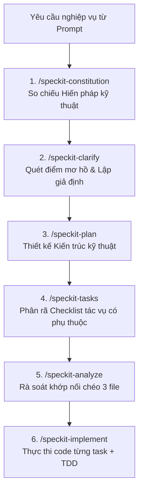

# CẨM NANG HƯỚNG DẪN: PHÂN TÍCH CHIỀU SÂU VỚI SPEC-KIT TRONG DỰ ÁN CDTN2

> **Tài liệu tham chiếu chuẩn cho Lập trình viên & AI Agent**  
> **Dự án:** Chuyên đề tốt nghiệp 2 — Nền tảng FreelanceHub (Nhóm 8)  
> **Mục tiêu:** Hướng dẫn cách prompt và cách AI tư duy phân tích chiều sâu ("Deep Analysis"), hiểu thấu đáo kiến trúc, kiểm soát rủi ro và ngăn ngừa triệt để tình trạng code hời hợt, sinh lỗi ngầm.

---

## 1. TẠI SAO PHẢI PHÂN TÍCH CHIỀU SÂU TRƯỚC KHI CODE?

Khi làm việc với các mô hình AI lập trình, vấn đề phổ biến nhất là:
- **Code vội vàng (Impulsive Coding):** Khi người dùng nói "Hãy viết API hủy đơn ứng tuyển", AI nhảy ngay vào tạo 1 method controller đơn giản mà không hề cân nhắc:
  - Sinh viên có được hủy đơn khi nhà tuyển dụng đã duyệt (`ACCEPTED`) không?
  - Có kiểm tra chống IDOR để sinh viên A không hủy đơn của sinh viên B không?
  - Quan hệ Job - Application có bị dính lỗi N+1 truy vấn không?
  - DTO đầu ra có chuẩn `ApiResponse<T>` theo tài liệu API contract không?
  - Frontend có hiển thị đúng nhãn song ngữ VI/EN và màu sắc theo CSS Tokens không?

**Giải pháp:** Áp dụng chuỗi 6 kỹ năng **GitHub Spec Kit** để thiết lập "hàng rào nhận thức" bắt buộc AI phải tư duy đa tầng trước khi xuất bất kỳ dòng code nào.

---

## 2. QUY TRÌNH 6 BƯỚC SPEC-KIT (SPEC-KIT COGNITIVE PIPELINE)



### Bước 1: `/speckit-constitution` — So chiếu Quy chuẩn Cốt lõi
- **Mục tiêu:** Nắm vững các "ranh giới đỏ" (non-negotiables) của dự án FreelanceHub.
- **Tài liệu gốc:** [.specify/memory/constitution.md](file:///c:/O%20E/Chuyen%20de%202/Project/Nhom%208_dev/cdtn2-NguyenBaAnhKhoi-se_test/.specify/memory/constitution.md)
- **Các nguyên tắc phải khắc cốt ghi tâm:**
  1. *Layered Clean Architecture:* Controller chỉ nhận request/gọi service/trả DTO. 100% logic nằm ở Service. Không trả Entity JPA ra ngoài API.
  2. *Zero-Trust Security:* Spring Security 6, Bearer JWT, `@PreAuthorize`, bắt buộc kiểm tra quyền sở hữu chống IDOR.
  3. *Dual/Triple Database:* Tương thích đồng thời MySQL 8, PostgreSQL 16 và H2. Tận dụng 13 index. Chống lỗi N+1 bằng `@EntityGraph` hoặc `JOIN FETCH`.
  4. *Frontend chuẩn:* React 18, TypeScript, CSS Variables token (`--bg-main`, `--text-main`), Song ngữ VI/EN (`LanguageContext`).
  5. *API Contract & Exceptions:* Định dạng chuẩn `ApiResponse<T>`, bắt lỗi tập trung tại `GlobalExceptionHandler`.

### Bước 2: `/speckit-clarify` — Quét & Làm rõ Điểm Mơ Hồ
- **Mục tiêu:** Phát hiện những điểm chưa rõ ràng, các trường hợp biên (edge cases) và quyền hạn trước khi thiết kế giải pháp.
- **Nội dung kiểm tra:**
  - Quyền hạn (Authorization): Ai được phép gọi? Role nào bị cấm?
  - Dữ liệu đầu vào (Validation): Độ dài, ký tự đặc biệt, định dạng email/ngày tháng.
  - Xử lý lỗi (Failure modes): Khi dữ liệu không tồn tại trả HTTP 404 hay 400? Mã lỗi nghiệp vụ là gì?
  - Trường hợp biên (Edge Cases): Số dư không đủ, hủy đơn đã hoàn thành, upload file quá dung lượng.
- **Đầu ra:** Bản tóm tắt các giả định (Assumptions) hoặc câu hỏi phản biện ngắn gọn gửi người dùng.

### Bước 3: `/speckit-plan` — Lập Kế Hoạch Kiến Trúc Kỹ Thuật
- **Mục tiêu:** Xác định chi tiết bản vẽ kỹ thuật trước khi gõ mã nguồn.
- **Nội dung thiết kế:**
  - Endpoint RESTful: Method (`POST`, `PUT`, `GET`), URI (`/api/v1/...`), Headers.
  - Cấu trúc DTO: `CreateXxxRequest`, `XxxResponse`.
  - Database & Entity: Bảng nào bị ảnh hưởng? Có cần bổ sung migration/index không? Truy vấn dùng JOIN FETCH ra sao?
  - Frontend Architecture: Service API method, State hook, Component phân tầng, i18n keys.
  - Chiến lược kiểm thử: Ca kiểm thử thành công, ca kiểm thử lỗi, mocking dependency.

### Bước 4: `/speckit-tasks` — Phân Rã Checklist Tác Vụ
- **Mục tiêu:** Chia nhỏ kế hoạch thành các task nguyên tử (atomic), có thứ tự phụ thuộc logic.
- **Cấu trúc phân rã chuẩn:**
  - `Phase 1: Setup & Contracts` (Tạo DTO, Error codes, Route).
  - `Phase 2: Data Tier` (Repository method, Query tối ưu).
  - `Phase 3: Core Business Logic` (Service method, Validation, IDOR check).
  - `Phase 4: Presentation Tier` (Controller endpoint, OpenAPI annotations, hoặc React Component & CSS).
  - `Phase 5: Automated Tests` (JUnit 5, Mockito, Vitest, E2E verification).

### Bước 5: `/speckit-analyze` — Rà Soát Khớp Nối Chéo
- **Mục tiêu:** Đóng vai trò Kiểm định viên độc lập (Auditor), đối chiếu 3 file:
  - `Spec (Yêu cầu)` ⇄ `Plan (Kiến trúc)` ⇄ `Tasks (Checklist)` ⇄ `Constitution (Hiến pháp)`.
- **Nội dung kiểm toán:**
  - Có task nào trong `tasks.md` mà `plan.md` chưa đề cập không?
  - Có DTO nào vi phạm quy tắc "Zero Entity Leakage" không?
  - Có endpoint nào thiếu kiểm tra IDOR không?
  - Có chuỗi text giao diện nào chưa đưa vào file i18n không?

### Bước 6: `/speckit-implement` — Thực Thi Tuần Tự & Kiểm Thử
- **Mục tiêu:** Viết code chính xác theo từng task, kiểm tra xanh (PASS) trước khi chuyển task.
- **Kỷ luật thực thi:**
  - Không viết code ngoài phạm vi task hiện tại.
  - Luôn viết/chạy test song hành theo nguyên tắc TDD.
  - Cập nhật trạng thái checkbox `[x]` sau khi hoàn thành mỗi task.

---

## 3. BỘ MẪU PROMPT CHUẨN HÓA DÀNH CHO NGƯỜI DÙNG (USER PROMPT TEMPLATES)

### Mẫu 1: Mega-Prompt Yêu Cầu Phân Tích Sâu (Khuyên Dùng)
*Dùng khi bạn muốn AI tự động kích hoạt tư duy sâu sắc, phân tích kiến trúc trước khi code:*

```text
Hãy áp dụng Giao thức Phân tích Chiều sâu (Spec-Kit Deep Analysis) để thực hiện tính năng sau:
[MÔ TẢ TÍNH NĂNG HOẶC YÊU CẦU CỦA BẠN]

Yêu cầu thực thi theo chuỗi 6 bước:
1. /speckit-constitution: Đối chiếu với quy chuẩn FreelanceHub (Clean Architecture, Spring Security 6, DTO pattern, Dual DB, Song ngữ VI/EN).
2. /speckit-clarify: Chỉ ra các điểm mơ hồ, các trường hợp biên (edge cases) và nêu rõ các giả định của bạn.
3. /speckit-plan: Thiết kế kiến trúc kỹ thuật chi tiết (API endpoints, DTOs, Repository query chống N+1, Luồng Service, Component FE).
4. /speckit-tasks: Phân rã checklist tác vụ chi tiết theo thứ tự phụ thuộc.
5. /speckit-analyze: Tự kiểm định chéo xem kế hoạch có khoảng hở hoặc vi phạm nào không.
6. /speckit-implement: Bắt đầu triển khai tuần tự từng task và chạy test kiểm chứng.
```

---

### Mẫu 2: Prompt Thực Hiện Từng Bước Tương Tác (Interactive Gated Mode)
*Dùng khi bạn muốn kiểm duyệt từng giai đoạn trước khi cho phép AI đi tiếp:*

**Bước 2.1 — Lập Kế Hoạch & Làm Rõ:**
```text
Hãy dùng /speckit-clarify và /speckit-plan để phân tích và lập kế hoạch kỹ thuật cho yêu cầu:
"[Mô tả ngắn gọn tính năng]"
Chưa viết code. Hãy xuất ra bản thiết kế API, DTO, Entity và các trường hợp biên để tôi duyệt trước.
```

**Bước 2.2 — Phân Rã Tác Vụ & Kiểm Định:**
```text
Kế hoạch đã ổn. Hãy dùng /speckit-tasks và /speckit-analyze để phân rã checklist công việc và tự rà soát khớp nối trước khi tiến hành code.
```

**Bước 2.3 — Thực Thi Code:**
```text
Checklist đã duyệt. Hãy dùng /speckit-implement để tiến hành code Task 1 và Task 2 kèm theo Unit test kiểm chứng.
```

---

### Mẫu 3: Prompt Sửa Lỗi Triệt Để (Architectural Bugfix)
*Dùng khi gặp lỗi hóc búa (500 Internal Error, N+1 query, rò rỉ dữ liệu IDOR, vỡ giao diện):*

```text
Hệ thống đang gặp lỗi sau:
[Dán log lỗi hoặc mô tả hành vi sai lệch]

Hãy dùng Giao thức Spec-Kit để xử lý:
1. Xác định nguyên nhân gốc rễ (Root Cause) đối chiếu theo .specify/memory/constitution.md.
2. Dùng /speckit-plan để đưa ra phương án sửa lỗi chuẩn kiến trúc (không vá tạm thời, không làm hỏng tính năng khác).
3. Dùng /speckit-implement để sửa mã nguồn và viết thêm ca kiểm thử (Regression Test) để lỗi này không bao giờ tái diễn.
```

---

## 4. BỘ 10 CÂU HỎI TỰ VẤN CỦA AI TRƯỚC KHI GÕ CODE (COGNITIVE CHECKLIST)

Trước khi viết bất kỳ file code nào, AI phải tự trả lời 10 câu hỏi sau:
1. **Vị trí code:** Code này thuộc tầng nào (Controller, Service, Repository, DTO, hay Component)? Có bị lẫn lộn trách nhiệm không?
2. **Entity JPA:** Mình có đang vô tình trả trực tiếp Entity JPA ra API không? Đã map qua Response DTO chưa?
3. **Hiệu năng CSDL:** Query này có nguy cơ gây lỗi N+1 khi duyệt danh sách không? Đã dùng `@EntityGraph` hoặc `JOIN FETCH` chưa?
4. **Bảo mật IDOR:** Người dùng hiện tại (`UserPrincipal`) có thực sự sở hữu tài nguyên này không? Đã có câu lệnh kiểm tra quyền chưa?
5. **Định dạng phản hồi:** API này có được bọc trong `ApiResponse<T>` chuẩn không?
6. **Xử lý ngoại lệ:** Khi dữ liệu không hợp lệ hoặc không tìm thấy, mình đã ném đúng Custom Exception để `GlobalExceptionHandler` bắt chưa?
7. **Frontend Design Tokens:** Component này có dùng CSS variables (`--bg-card`, `--text-main`) không, hay đang hardcode mã màu hex `#ffffff`?
8. **Đa ngôn ngữ:** Mọi chuỗi hiển thị trên giao diện đã được định nghĩa trong `LanguageContext` chưa?
9. **Kiểm thử tự động:** Ca kiểm thử JUnit 5 / Vitest cho tính năng này đã được định nghĩa chưa?
10. **Definition of Done:** Thay đổi này có vượt qua build Maven (`mvn compile`) và kiểm tra lint không?

---
*Tài liệu này là chuẩn mực thực thi trong toàn bộ dự án Chuyên đề tốt nghiệp 2 — FreelanceHub.*

