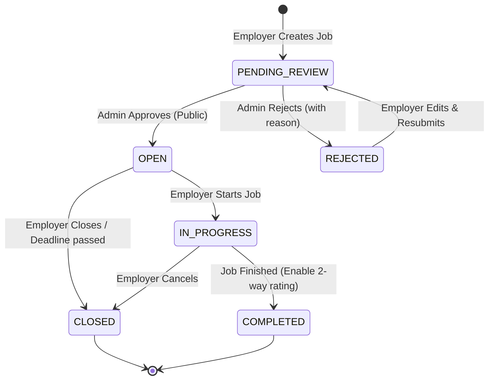

# Data Model: Part-time P0 Gap Completion & Student Safety

**Feature**: `001-parttime-p0-completion`  
**Date**: 2026-11-06  
**Status**: Completed  

---

## 1. Entity Modifications & Additions

### 1.1. Modified Entity: `Job` (`jobs` table)

| Field | Type | Nullable | Default | Description / Validation |
|---|---|:---:|---|---|
| `id` | `Long` (PK) | No | Auto | Primary Key (IDENTITY) |
| `employer` | `User` (FK) | No | - | ManyToOne `employer_id` (NTD sở hữu) |
| `category` | `Category` (FK) | No | - | ManyToOne `category_id` |
| `title` | `String` | No | - | Tiêu đề tin (max 255 chars) |
| `description` | `String` (TEXT) | No | - | Mô tả công việc |
| `requirements` | `String` (TEXT) | Yes | - | Yêu cầu ứng tuyển |
| `jobType` | `String` | No | - | `PART_TIME`, `FREELANCE`, `INTERNSHIP` |
| `workMode` | `String` | Yes | `'ONSITE'` | `ONSITE`, `REMOTE`, `HYBRID` |
| `location` | `String` | Yes | - | Địa chỉ nơi làm việc |
| `province` | `String` | Yes | - | Tỉnh / Thành phố (chuẩn hóa 34 tỉnh) |
| `salaryType` | `String` | No | - | `HOURLY`, `FIXED_PROJECT`, `MONTHLY` |
| `salaryAmount` | `BigDecimal` | No | - | Mức lương (precision 12, scale 2) |
| `salaryText` | `String` | Yes | - | Chuỗi lương hiển thị (VD: "28.000đ/giờ") |
| `workingHours` | `String` | Yes | - | Ghi chú ca làm chi tiết (text tự do) |
| **`shiftType`** *(NEW)* | `String` | Yes | `'FLEXIBLE'` | Phân loại ca: `MORNING`, `AFTERNOON`, `EVENING`, `WEEKEND`, `FLEXIBLE` |
| `benefits` | `String` (TEXT) | Yes | - | Quyền lợi sinh viên |
| `studentFriendly` | `Boolean` | Yes | `true` | Đánh dấu việc làm ưu tiên sinh viên |
| `slotsAvailable` | `Integer` | Yes | `1` | Số lượng cần tuyển |
| **`status`** *(UPDATED)* | `String` | Yes | `'PENDING_REVIEW'` | Vòng đời: `PENDING_REVIEW`, `OPEN`, `IN_PROGRESS`, `COMPLETED`, `CLOSED`, `REJECTED` |
| **`rejectionReason`** *(NEW)* | `String` | Yes | `null` | Lý do Admin từ chối tin duyệt (max 255 chars) |
| `deadline` | `LocalDateTime` | Yes | - | Hạn nộp hồ sơ |
| `createdAt` | `LocalDateTime` | No | `NOW()` | Thời gian tạo |
| `updatedAt` | `LocalDateTime` | No | `NOW()` | Thời gian cập nhật |

#### Job State Transition Diagram



---

### 1.2. New Entity: `Report` (`reports` table)

Lưu trữ các báo cáo phản ánh tin tuyển dụng có dấu hiệu lừa đảo, sai phạm do người dùng gửi lên.

| Field | Type | Nullable | Default | Description / Validation |
|---|---|:---:|---|---|
| `id` | `Long` (PK) | No | Auto | Primary Key (IDENTITY) |
| `reporter` | `User` (FK) | No | - | ManyToOne `reporter_id` (Người gửi báo cáo) |
| `job` | `Job` (FK) | No | - | ManyToOne `job_id` (Tin tuyển dụng bị báo cáo) |
| `reason` | `String` | No | - | Enum/String: `SCAM_DEPOSIT`, `FALSE_INFO`, `INAPPROPRIATE`, `OTHER` |
| `description` | `String` (TEXT) | Yes | - | Nội dung mô tả chi tiết của người báo cáo |
| `status` | `String` | No | `'PENDING'` | Trạng thái: `PENDING`, `RESOLVED`, `DISMISSED` |
| `resolvedBy` | `User` (FK) | Yes | `null` | ManyToOne `resolved_by` (Admin xử lý) |
| `resolutionNotes` | `String` (TEXT) | Yes | `null` | Ghi chú quyết định xử lý của Admin |
| `createdAt` | `LocalDateTime` | No | `NOW()` | Thời điểm gửi báo cáo |
| `resolvedAt` | `LocalDateTime` | Yes | `null` | Thời điểm Admin hoàn tất xử lý |

**Ràng buộc Nghiệp vụ (Business Constraint):**
- Mỗi người dùng chỉ được có tối đa 1 báo cáo ở trạng thái `PENDING` cho 1 tin việc làm cụ thể (`UNIQUE(reporter_id, job_id, status)` hoặc kiểm tra qua Service).

---

### 1.3. New Entity: `PasswordResetToken` (`password_reset_tokens` table)

Quản lý mã xác thực phục vụ quy trình đặt lại mật khẩu của người dùng.

| Field | Type | Nullable | Default | Description / Validation |
|---|---|:---:|---|---|
| `id` | `Long` (PK) | No | Auto | Primary Key (IDENTITY) |
| `token` | `String` | No | - | Mã token UUID ngẫu nhiên duy nhất (length 100) |
| `user` | `User` (FK) | No | - | ManyToOne `user_id` |
| `expiryDate` | `LocalDateTime` | No | - | Thời điểm hết hạn (mặc định 15 phút từ lúc tạo) |
| `used` | `Boolean` | No | `false` | Đánh dấu token đã được sử dụng hay chưa |
| `createdAt` | `LocalDateTime` | No | `NOW()` | Thời điểm tạo mã |

---

## 2. Database Indexes & DDL Script

Tệp migration: `database/migrations/V2__add_job_moderation_reports_and_shifts.sql`

```sql
-- 1. Bổ sung cột cho bảng jobs
ALTER TABLE jobs ADD COLUMN IF NOT EXISTS shift_type VARCHAR(50) DEFAULT 'FLEXIBLE';
ALTER TABLE jobs ADD COLUMN IF NOT EXISTS rejection_reason VARCHAR(255);

-- 2. Tạo bảng reports
CREATE TABLE IF NOT EXISTS reports (
    id SERIAL PRIMARY KEY,
    reporter_id INT NOT NULL REFERENCES users(id) ON DELETE CASCADE,
    job_id INT NOT NULL REFERENCES jobs(id) ON DELETE CASCADE,
    reason VARCHAR(100) NOT NULL,
    description TEXT,
    status VARCHAR(50) DEFAULT 'PENDING', -- PENDING, RESOLVED, DISMISSED
    resolved_by INT REFERENCES users(id) ON DELETE SET NULL,
    resolution_notes TEXT,
    created_at TIMESTAMP WITH TIME ZONE DEFAULT CURRENT_TIMESTAMP,
    resolved_at TIMESTAMP WITH TIME ZONE
);

-- 3. Tạo bảng password_reset_tokens
CREATE TABLE IF NOT EXISTS password_reset_tokens (
    id SERIAL PRIMARY KEY,
    token VARCHAR(100) UNIQUE NOT NULL,
    user_id INT NOT NULL REFERENCES users(id) ON DELETE CASCADE,
    expiry_date TIMESTAMP WITH TIME ZONE NOT NULL,
    used BOOLEAN DEFAULT FALSE,
    created_at TIMESTAMP WITH TIME ZONE DEFAULT CURRENT_TIMESTAMP
);

-- 4. Tạo chỉ mục tối ưu truy vấn
CREATE INDEX IF NOT EXISTS idx_jobs_shift_type ON jobs(shift_type);
CREATE INDEX IF NOT EXISTS idx_reports_job_id ON reports(job_id);
CREATE INDEX IF NOT EXISTS idx_reports_status ON reports(status);
CREATE INDEX IF NOT EXISTS idx_reports_reporter_id ON reports(reporter_id);
CREATE INDEX IF NOT EXISTS idx_reset_tokens_token ON password_reset_tokens(token);
CREATE INDEX IF NOT EXISTS idx_reset_tokens_user_id ON password_reset_tokens(user_id);
```

