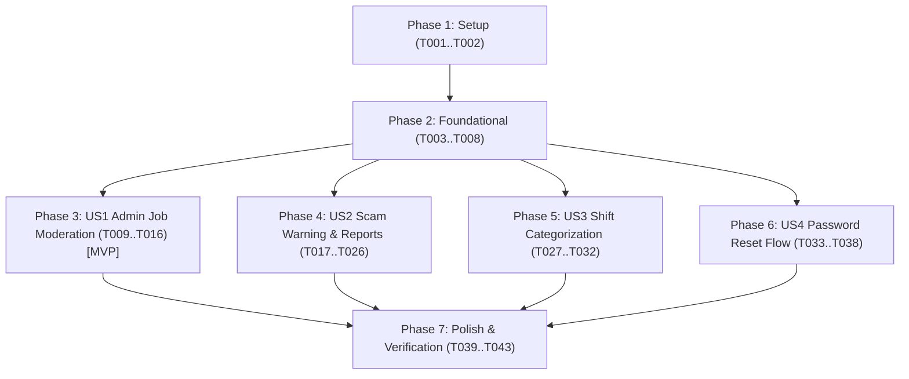

# Tasks: Part-time P0 Gap Completion & Student Safety (Hoàn thiện Lỗ hổng Cốt lõi P0 & An toàn Việc làm Sinh viên)

**Input**: Design documents from `specs/001-parttime-p0-completion/`  
**Prerequisites**: `plan.md`, `spec.md`, `research.md`, `data-model.md`, `contracts/api-contracts.md`, `quickstart.md`  
**Organization**: Tasks are grouped by user story to enable independent implementation and testing of each story.

## Format: `- [ ] [ID] [P?] [Story?] Description with file path`
- **[P]**: Can run in parallel (different files, no dependencies)
- **[Story]**: Which user story this task belongs to (US1, US2, US3, US4)

---

## Phase 1: Setup (Shared Infrastructure & Migrations)

**Purpose**: Database schema migration and initialization for new entities

- [x] T001 Create database migration script in `database/migrations/V2__add_job_moderation_reports_and_shifts.sql`
- [x] T002 [P] Update baseline schema file in `database/schema.sql` to maintain sync for fresh environments

---

## Phase 2: Foundational (Core Entities & Shared Infrastructure)

**Purpose**: Core entities, repositories, and security configurations required by user stories

- [x] T003 [P] Update `Job.java` in `backend/src/main/java/com/nhom8/freelance/models/Job.java` with `shiftType`, `rejectionReason`, and default status `PENDING_REVIEW`
- [x] T004 [P] Create `Report.java` entity in `backend/src/main/java/com/nhom8/freelance/models/Report.java`
- [x] T005 [P] Create `PasswordResetToken.java` entity in `backend/src/main/java/com/nhom8/freelance/models/PasswordResetToken.java`
- [x] T006 [P] Create `ReportRepository.java` in `backend/src/main/java/com/nhom8/freelance/repositories/ReportRepository.java`
- [x] T007 [P] Create `PasswordResetTokenRepository.java` in `backend/src/main/java/com/nhom8/freelance/repositories/PasswordResetTokenRepository.java`
- [x] T008 [P] Update `SecurityConfig.java` in `backend/src/main/java/com/nhom8/freelance/config/SecurityConfig.java` to allow public access to `/auth/forgot-password` and `/auth/reset-password`

**Checkpoint**: Foundation ready — user story implementation can proceed independently

---

## Phase 3: User Story 1 - Admin Job Moderation Queue (Priority: P1) 🎯 MVP

**Goal**: Employer posts jobs with status `PENDING_REVIEW`; Admin reviews in queue, approves (`OPEN`) or rejects (`REJECTED`) with reasons; only approved jobs are public.

**Independent Test**: Post a job as employer $\rightarrow$ verify it is not visible publicly $\rightarrow$ approve as admin $\rightarrow$ verify it appears on `/jobs` and employer receives notification.

### Implementation for User Story 1
- [x] T009 [P] [US1] Create request DTO `JobReviewRequest.java` in `backend/src/main/java/com/nhom8/freelance/dto/request/JobReviewRequest.java`
- [x] T010 [US1] Add query method `findByStatusOrderByCreatedAtDesc` in `backend/src/main/java/com/nhom8/freelance/repositories/JobRepository.java`
- [x] T011 [US1] Implement `getPendingJobs` and `reviewJob` in `backend/src/main/java/com/nhom8/freelance/services/JobService.java` with notification dispatch
- [x] T012 [US1] Add endpoints `GET /admin/jobs/pending` and `PATCH /admin/jobs/{id}/review` in `backend/src/main/java/com/nhom8/freelance/controllers/AdminController.java`
- [x] T013 [P] [US1] Update API client methods for pending jobs and review in `frontend/src/services/adminService.ts`
- [x] T014 [US1] Add "Tin chờ duyệt" tab, Approve button, and Rejection modal in `frontend/src/pages/admin/ManageJobsPage.tsx`
- [x] T015 [US1] Update `frontend/src/pages/employer/MyJobsPage.tsx` to display `PENDING_REVIEW` badge and rejection explanation
- [x] T016 [P] [US1] Unit test job moderation logic in `backend/src/test/java/com/nhom8/freelance/services/JobServiceTest.java`

**Checkpoint**: User Story 1 fully functional and independently verified.

---

## Phase 4: User Story 2 - Scam Warning & Job Reporting System (Priority: P1)

**Goal**: Student sees anti-scam warning on job details, reports suspicious jobs, and Admin investigates and resolves reports.

**Independent Test**: Open job details $\rightarrow$ view safety warning card $\rightarrow$ click "Báo cáo tin", submit reason $\rightarrow$ Admin opens `/admin/reports` and resolves by taking down job.

### Implementation for User Story 2
- [x] T017 [P] [US2] Create DTOs `ReportCreateRequest.java` and `ReportResolveRequest.java` in `backend/src/main/java/com/nhom8/freelance/dto/request/`
- [x] T018 [US2] Implement `ReportService.java` in `backend/src/main/java/com/nhom8/freelance/services/ReportService.java` (create report, duplicate check, resolve actions)
- [x] T019 [US2] Create `ReportController.java` in `backend/src/main/java/com/nhom8/freelance/controllers/ReportController.java` (`POST /reports`)
- [x] T020 [US2] Add endpoints `GET /admin/reports` and `PATCH /admin/reports/{id}/resolve` in `backend/src/main/java/com/nhom8/freelance/controllers/AdminController.java`
- [x] T021 [P] [US2] Create API client `frontend/src/services/reportService.ts`
- [x] T022 [P] [US2] Create component `ScamWarningBanner.tsx` in `frontend/src/components/jobs/ScamWarningBanner.tsx`
- [x] T023 [P] [US2] Create component `ReportJobModal.tsx` in `frontend/src/components/jobs/ReportJobModal.tsx`
- [x] T024 [US2] Integrate `ScamWarningBanner` and `ReportJobModal` into `frontend/src/pages/JobDetailPage.tsx`
- [x] T025 [US2] Create Admin page `frontend/src/pages/admin/ManageReportsPage.tsx` and register route in `frontend/src/App.tsx`
- [x] T026 [P] [US2] Unit test report submission and resolution in `backend/src/test/java/com/nhom8/freelance/services/ReportServiceTest.java`

**Checkpoint**: User Story 2 fully functional and independently verified.

---

## Phase 5: User Story 3 - Part-time Shift Categorization & Quick Filters (Priority: P2)

**Goal**: Standardize shift types (`MORNING`, `AFTERNOON`, `EVENING`, `WEEKEND`, `FLEXIBLE`); enable quick filter chips on job browse page.

**Independent Test**: Post job with `EVENING` shift $\rightarrow$ open `/jobs` $\rightarrow$ click chip "Ca tối" $\rightarrow$ only evening shift jobs are returned.

### Implementation for User Story 3
- [x] T027 [US3] Update `JobCreateRequest.java` in `backend/src/main/java/com/nhom8/freelance/dto/request/JobCreateRequest.java` with `shiftType`
- [x] T028 [US3] Update `searchJobs` query in `backend/src/main/java/com/nhom8/freelance/repositories/JobRepository.java` and `JobService.java` to filter by `shiftType`
- [x] T029 [US3] Update `JobController.java` in `backend/src/main/java/com/nhom8/freelance/controllers/JobController.java` to accept `@RequestParam(required = false) String shiftType`
- [x] T030 [P] [US3] Update `frontend/src/components/jobs/JobCard.tsx` to render shift badge with distinct styling
- [x] T031 [P] [US3] Update `frontend/src/pages/PostJobPage.tsx` to include shift type selector
- [x] T032 [US3] Add quick filter chips for shifts in `frontend/src/pages/JobBrowsePage.tsx`

**Checkpoint**: User Story 3 fully functional and independently verified.

---

## Phase 6: User Story 4 - Secure Password Reset Flow (Priority: P2)

**Goal**: Allow users to request password reset via email, generate a secure token, and update password without account enumeration leak.

**Independent Test**: Click "Quên mật khẩu" on login $\rightarrow$ enter email $\rightarrow$ receive reset token $\rightarrow$ submit new password $\rightarrow$ login with new password.

### Implementation for User Story 4
- [x] T033 [P] [US4] Create DTOs `ForgotPasswordRequest.java` and `ResetPasswordRequest.java` in `backend/src/main/java/com/nhom8/freelance/dto/request/`
- [x] T034 [US4] Implement `createPasswordResetToken` and `resetPassword` in `backend/src/main/java/com/nhom8/freelance/services/AuthService.java`
- [x] T035 [US4] Add endpoints `POST /auth/forgot-password` and `POST /auth/reset-password` in `backend/src/main/java/com/nhom8/freelance/controllers/AuthController.java`
- [x] T036 [P] [US4] Update API client in `frontend/src/services/authService.ts`
- [x] T037 [US4] Create `ForgotPasswordModal.tsx` in `frontend/src/components/common/ForgotPasswordModal.tsx` and integrate into `frontend/src/pages/LoginPage.tsx`
- [x] T038 [P] [US4] Unit test password reset logic in `backend/src/test/java/com/nhom8/freelance/services/AuthServiceTest.java`

**Checkpoint**: User Story 4 fully functional and independently verified.

---

## Phase 7: Polish, Documentation & Verification

**Purpose**: System integration verification, contract documentation, and end-to-end check

- [x] T039 [P] Update `docs/api-contract.md` with new endpoints and DTO definitions
- [x] T040 [P] Update `docs/FEATURE_AUDIT.md` to record all resolved P0 items
- [x] T041 Run backend automated test suite (`./mvnw clean test`) and ensure 100% green
- [x] T042 Run frontend TypeScript build check (`npm run build`) and fix any type discrepancies
- [x] T043 Execute verification walkthrough scenarios from `quickstart.md`

---

## Dependencies & Execution Order

### Parallel Opportunities

- **Phase 1 & 2**: `T002`, `T003`, `T004`, `T005`, `T006`, `T007`, `T008` can run in parallel.
- **Across User Stories**: Once Phase 2 is complete, User Stories US1, US2, US3, US4 can proceed in parallel.
- **Within US1**: `T009`, `T013`, `T016` can run in parallel with backend service work.
- **Within US2**: `T017`, `T021`, `T022`, `T023`, `T026` can run in parallel.
- **Within US3**: `T030`, `T031` can run in parallel with backend repository work.
- **Within US4**: `T033`, `T036`, `T038` can run in parallel.

---

## Implementation Strategy

1. **MVP First**: Complete Phase 1 (Setup) $\rightarrow$ Phase 2 (Foundational) $\rightarrow$ Phase 3 (US1: Admin Moderation). At this point, the core P0 loop is already secured.
2. **Incremental Delivery**: Add US2 (Anti-scam & Reports) $\rightarrow$ Add US3 (Shift filter) $\rightarrow$ Add US4 (Password reset).
3. **Verification**: Execute Phase 7 (Polish & Tests) to verify zero regression across the existing 1.470+ jobs and user workflows.

